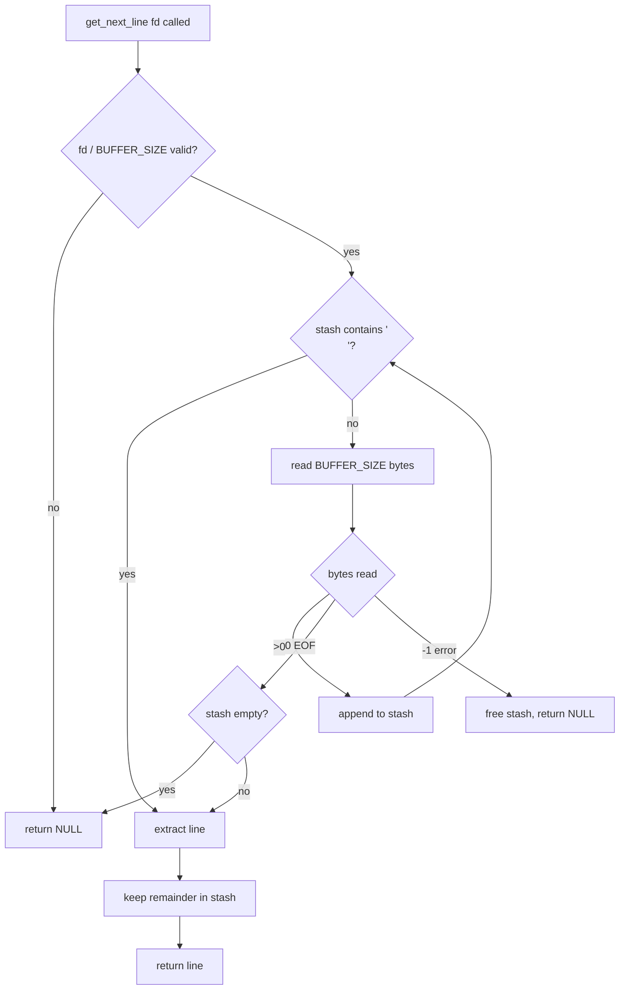
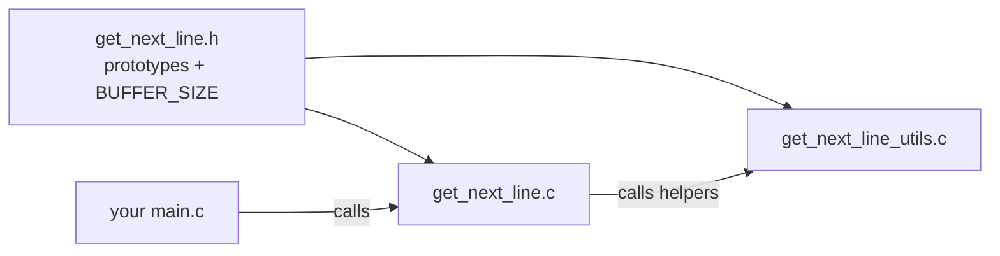

# Get Next Line — Study Guide & Implementation Roadmap

*This project has been created as part of the 42 curriculum by `<login>`.*

> **How to use this file.** This is a **learning course + implementation guide** built from the official subject (*Get Next Line, version 14.3*). It deliberately gives **pseudocode, small examples and reasoning**, not a complete solution. The subject's own AI rules say: *"You should not ask for direct answers to the AI"* and *"The learning journey is more important than the result."* Use this guide to understand, then write the code yourself.
>
> Before you submit, replace this file with a README that follows **Chapter V** of the subject (template in [Section 12](#12-the-readme-you-must-submit-chapter-v)).

---

## Table of Contents

1. [Analysis of the official subject](#1-analysis-of-the-official-subject)
2. [Project overview](#2-project-overview)
3. [Theoretical foundations](#3-theoretical-foundations)
4. [Step-by-step implementation guide](#4-step-by-step-implementation-guide)
5. [Project structure & file organization](#5-project-structure--file-organization)
6. [Functions, algorithm & data structures](#6-functions-algorithm--data-structures)
7. [Compilation & execution](#7-compilation--execution)
8. [Testing & debugging strategy](#8-testing--debugging-strategy)
9. [Evaluation & defense preparation](#9-evaluation--defense-preparation)
10. [Troubleshooting](#10-troubleshooting)
11. [Learning resources](#11-learning-resources)
12. [The README you must submit (Chapter V)](#12-the-readme-you-must-submit-chapter-v)
13. [Final verification & assumptions](#13-final-verification--assumptions)

---

## 1. Analysis of the official subject

### 1.1 Mandatory requirements (extracted from the subject)

| # | Requirement | Source |
|---|-------------|--------|
| M1 | Written in **C**, following the **Norm** (bonus files are included in the norm check; a norm error = **0**) | Ch. II |
| M2 | No unexpected crash (segfault, bus error, double free…) except undefined behavior, otherwise **0** | Ch. II |
| M3 | All heap memory properly freed. **No leaks tolerated** | Ch. II |
| M4 | If a Makefile is required: flags `-Wall -Wextra -Werror`, compiler `cc`, no unnecessary relinking, rules `$(NAME)`, `all`, `clean`, `fclean`, `re` | Ch. II |
| M5 | Prototype exactly: `char *get_next_line(int fd);` | Ch. IV |
| M6 | Files to submit, **at the root of the repo**: `get_next_line.c`, `get_next_line_utils.c`, `get_next_line.h` | Ch. IV |
| M7 | Allowed external functions: **`read`, `malloc`, `free`** (only these) | Ch. IV |
| M8 | Return the line read; **`NULL`** if nothing left to read **or** an error occurred | Ch. IV |
| M9 | Repeated calls read the file **one line at a time** | Ch. IV |
| M10 | Must work on **files and standard input** | Ch. IV |
| M11 | Returned line **includes the terminating `\n`**, except when EOF is reached and the file doesn't end with `\n` | Ch. IV |
| M12 | Header contains at least the prototype of `get_next_line()` | Ch. IV |
| M13 | Helper functions go in `get_next_line_utils.c` | Ch. IV |
| M14 | Must compile **with and without** `-D BUFFER_SIZE=n`; you choose the default value | Ch. IV |
| M15 | Compile command: `cc -Wall -Wextra -Werror -D BUFFER_SIZE=42 <files>.c` | Ch. IV |
| M16 | Read as little as possible per call: **on a newline, return the current line**. Don't read the whole file first | Ch. IV |
| M17 | **Forbidden:** your libft, `lseek()`, **global variables** | Ch. IV |
| M18 | A `README.md` at the repo root with the required content | Ch. V |
| M19 | Be ready for a **small live modification** during evaluation | Ch. VII |

### 1.2 Undefined behavior (allowed to misbehave, per the subject)

- The file is **modified after the last call** while `read()` hasn't reached EOF.
- Reading a **binary file** (you *may* handle it logically, but it's not required).

### 1.3 Bonus (assessed **only if the mandatory part is perfect**)

| # | Requirement |
|---|-------------|
| B1 | Use **only one static variable** |
| B2 | Handle **multiple file descriptors** simultaneously, without losing each one's reading state or returning a line from the wrong fd |
| B3 | Extra files: `get_next_line_bonus.c`, `get_next_line_bonus.h`, `get_next_line_utils_bonus.c` (at the root) |
| B4 | The bonus needs a `bonus` rule in the Makefile *if* a Makefile is used (Ch. II) |

### 1.4 Ambiguities / things the subject does **not** specify

Do not assume these are "required"; decide consciously and be ready to justify:

- **Default `BUFFER_SIZE`:** "You may choose any default value you prefer."
- **`BUFFER_SIZE <= 0`:** not specified. Returning `NULL` is a sensible choice (*recommendation*).
- **Whether a Makefile is needed at all:** Ch. II says "*if the subject requires it*", and this subject's submission list names only `.c`/`.h` files and shows a direct `cc` command. Check your campus' evaluation guidelines. Writing a Makefile is harmless but is not demanded by this subject text.
- **Norm details** (line limits, function counts, etc.) are **not in this PDF**; they come from the separate Norm document. Verify them there.
- **What an `fd` error means:** the subject only says "an error occurred" → `NULL`.
- **How the "one static variable" is defined** for the bonus: see [Section 6.5](#65-bonus-multiple-file-descriptors).

---

## 2. Project overview

### What is it?
You write **one function**, `get_next_line()`, which returns **the next line** of whatever a file descriptor points to, every time it is called.

```c
int   fd = open("poem.txt", O_RDONLY);
char *line;

while ((line = get_next_line(fd)) != NULL)
{
    printf("%s", line);   /* the line already contains its '\n' */
    free(line);           /* the CALLER frees what you returned */
}
```

### Main objective
Make a reusable, leak-free, robust "read a line" function that works for **any** `BUFFER_SIZE`, any line length, files *and* stdin.

### Why it matters
- You face the **fundamental problem of buffered I/O**: `read()` gives you *chunks*, not lines.
- You master **static variables** (state that survives between calls).
- You practice **dynamic memory ownership** (who allocates, who frees).
- It's a function you will reuse in later projects (the subject suggests adding it to your libft once passed).

### Skills you will learn
`read()` and file descriptors · static storage duration · heap management · string handling without `<string.h>` · edge-case thinking · testing with sanitizers/Valgrind.

### General workflow



---

## 3. Theoretical foundations

### 3.1 File descriptors

1. **What:** a small non-negative integer the OS gives you to refer to an open "file" (regular file, pipe, terminal, socket…).
2. **Why:** a uniform interface: `read()` doesn't care *what* it reads from.
3. **Problem solved:** programs can treat files, keyboards and pipes the same way.
4. **Internally:** the kernel keeps a per-process table mapping integers → open file descriptions, each with its own **current offset**. Each `read()` advances that offset.
5. **In this project:** `fd` is your only input. `0` = stdin, `1` = stdout, `2` = stderr; `open()` returns the next free number (usually ≥ 3).
6. **Example:** `read(0, buf, 10)` reads from the keyboard/pipe.
7. **Mistakes:** assuming `fd` always refers to a seekable file; forgetting that `fd` can be invalid (`-1`, closed).
8. **Edge cases:** `fd < 0`, closed fd, directory, stdin from a pipe, terminal input (`Ctrl+D` = EOF).
9. **Defense questions:** *Why does the subject say "a file descriptor does not only point to regular files"? What happens if you call it with `fd = -1`?*

### 3.2 `read()`

```c
ssize_t read(int fd, void *buf, size_t count);
```

1. **What:** asks the kernel for up to `count` bytes from `fd` into `buf`.
2. **Why/Problem:** the lowest-level portable way to get bytes.
3. **Internally:** a **system call**. Switching to kernel mode is *expensive*, which is why reading 1 byte at a time is slow and why `BUFFER_SIZE` exists.
4. **Return value (crucial):**

| Return | Meaning |
|--------|---------|
| `> 0` | number of bytes actually read (**may be less than `count`**) |
| `0` | **End of file** |
| `-1` | **Error** |

5. **Key facts:**
   - `read()` does **not** add a `'\0'`. **You** must terminate your strings.
   - A short read is **normal** (pipes, terminals, end of file).
   - The offset advances; you **can't un-read** (and `lseek()` is forbidden), so anything read beyond the current line must be **saved** by you.
6. **Mistakes:** treating `read` return `0` and `-1` the same way; forgetting to null-terminate; assuming one `read` = one line.
7. **Edge cases:** `BUFFER_SIZE = 1`, huge `BUFFER_SIZE`, empty file, file without final `\n`.
8. **Defense questions:** *What does `read` return at EOF? What if it returns fewer bytes than asked? Why can't you throw away the extra bytes you read?*

### 3.3 The core problem: chunks vs lines

`read()` delivers fixed-size chunks; lines have arbitrary length.

```
File content:   "Hello\nWorld\nBye"
BUFFER_SIZE=4:  [Hell] [o\nWo] [rld\n] [Bye]
```

Call #1 must return `"Hello\n"`. But the 2nd chunk `o\nWo` contains the end of line 1 **and the start of line 2**. `"Wo"` has been consumed from the fd, so it must be **remembered until the next call**. That remembered data is the **stash** (also called *remainder*, *backup*, *leftover*).

### 3.4 Static variables

1. **What:** a variable declared with `static` inside a function has **static storage duration**: it lives for the whole program, but is only *visible* inside that function.
2. **Why:** you need state that survives between calls **without a global variable** (forbidden).
3. **Internally:** stored in the data/BSS segment (not stack, not heap); initialized once, before the program starts (to `0`/`NULL` by default).
4. **In this project:** holds the stash.
5. **Example:**

```c
int counter(void)
{
    static int n = 0;   /* initialised ONCE */
    n++;
    return (n);
}
/* counter() → 1, counter() → 2, counter() → 3 … */
```

6. **Mistakes:**
   - Thinking `static int n = 0;` resets on every call (it doesn't).
   - Storing a pointer in a static and then forgetting it points to **heap memory you must still free**. The static pointer itself isn't freed automatically.
   - Static is **not** thread-safe (not relevant here).
7. **Edge cases:** the stash must be correctly reset to `NULL` after being freed, otherwise the next call uses a dangling pointer.
8. **Defense questions:** *Where does a static variable live? Why is it allowed but a global isn't? What's the difference in visibility between them?*

### 3.5 Memory layout: stack vs heap

| | Stack | Heap |
|---|---|---|
| Managed by | compiler (automatic) | **you** (`malloc`/`free`) |
| Lifetime | until function returns | until `free` |
| Size | small, limited | large |
| Used here for | local `char buf[...]`? (see warning) | stash, returned line |

> ⚠️ **Warning:** `BUFFER_SIZE` can be `10000000`. A local `char buf[BUFFER_SIZE + 1];` would then be ~10 MB **on the stack** and may crash (stack overflow) → violates M2. Think about where the read buffer should live. This is exactly the subject's hint: *"Does your function still work if the BUFFER_SIZE value is 9999? If it is 1? 10000000? Do you know why?"*

### 3.6 Dynamic allocation (`malloc` / `free`)

1. **What:** request/release heap memory at runtime.
2. **Why:** line length is unknown at compile time.
3. **Rules to live by:**
   - Always check `malloc` for `NULL`.
   - Allocate `length + 1` for the `'\0'`.
   - **Every** allocation has exactly **one owner** at any moment. Decide who frees it.
   - After `free(p)`, set `p = NULL` (especially your static stash).
4. **Ownership in this project:**
   - The **returned line** belongs to the **caller** (they `free` it).
   - The **stash** belongs to **you**; free it on EOF, on error, and whenever it becomes empty.
5. **Mistakes:** leaks on error paths; double free; use-after-free; forgetting `+1`; leaking the old stash when replacing it (`stash = join(stash, buf)` leaks the old `stash` unless the join frees it).
6. **Defense questions:** *Who frees the returned line? Where are the leak risks on the EOF/error paths? How did you prove there are no leaks?*

### 3.7 Strings in C **without `<string.h>`**

Allowed external functions are only `read`, `malloc`, `free` (M7). So **`strlen`, `strchr`, `strjoin`, `memcpy`, `strdup`, `substr`… are not available** and your libft is forbidden. You must write your own small helpers in `get_next_line_utils.c`.

- A C string is a `char` array ended by `'\0'`; its length is *not stored*.
- Every helper must tolerate `NULL` input where it can occur (first call: stash is `NULL`).
- Off-by-one errors live here. Always ask: *"is there room for the `'\0'`?"*

### 3.8 Newline & EOF semantics (from the subject)

| File content | Calls return |
|---|---|
| `"a\nb\n"` | `"a\n"`, `"b\n"`, `NULL` |
| `"a\nb"` (no final `\n`) | `"a\n"`, `"b"`, `NULL` |
| `""` (empty) | `NULL` |
| `"\n"` | `"\n"`, `NULL` |
| `"\n\n"` | `"\n"`, `"\n"`, `NULL` |

The line **keeps** its `\n` (except for a final unterminated line).

### 3.9 Standard input

`get_next_line(0)` must work. On a terminal, `read` returns after each Enter press (a *short read* with `\n`), and `Ctrl+D` signals EOF. With a pipe (`echo "a\nb" | ./test`) data arrives in arbitrary chunks. Your algorithm must **not** assume the buffer fills completely.

### 3.10 Compile-time macros: `-D BUFFER_SIZE=n`

`-D BUFFER_SIZE=42` is equivalent to `#define BUFFER_SIZE 42` before your code. Since the subject requires compiling **with and without** the flag, you must provide a default:

```c
#ifndef BUFFER_SIZE
# define BUFFER_SIZE 42   /* your choice */
#endif
```

Where this goes (header) matters for both mandatory and bonus builds.

### 3.11 Header guards

`get_next_line.h` needs include guards and the includes your code uses (`<unistd.h>` for `read`/`ssize_t`, `<stdlib.h>` for `malloc`/`free`). Mind the Norm rules for headers.

---

## 4. Step-by-step implementation guide

### Phase 0 — Understand before coding

- **Objective:** be able to explain the problem on paper.
- **Do:** draw the `Hello\nWorld\nBye` example with `BUFFER_SIZE` = 1, 4, 100 and trace by hand what the stash holds after each call.
- **Checkpoint:**
  - [ ] I can explain why a stash is needed.
  - [ ] I can explain what a static variable is.
  - [ ] I can explain the 3 return values of `read`.

### Phase 1 — Setup & skeleton

- **Objective:** a compiling project with the right files.
- **Implementation:**
  1. Create `get_next_line.c`, `get_next_line_utils.c`, `get_next_line.h` at repo root.
  2. In the header: guards, includes, `BUFFER_SIZE` default, prototype (exactly as the subject) + your helper prototypes.
  3. Make `get_next_line()` return `NULL` for now.
- **Test:** `cc -Wall -Wextra -Werror -D BUFFER_SIZE=42 get_next_line.c get_next_line_utils.c main.c`
- **Common errors:** missing include → implicit declaration (`-Werror` makes it fatal); `BUFFER_SIZE` undefined when compiled without the flag.
- **Checkpoint:**
  - [ ] Compiles with **and without** `-D BUFFER_SIZE`.
  - [ ] Zero warnings.

### Phase 2 — Helper functions

- **Objective:** replace the forbidden libc string functions.
- **Implementation:** write small, independent helpers (names are *suggestions*, not subject requirements):

| Helper (suggested) | Job |
|---|---|
| `ft_strlen` | length of a string (handle `NULL` → 0) |
| `ft_strchr`-like | find `'\n'` (or report "none") |
| `ft_strjoin`-like | concatenate stash + new buffer into a **new** allocation, freeing what must be freed |
| `ft_substr`/`ft_strdup`-like | copy a portion (line extraction / remainder) |

- **Pseudocode (join):**

```text
join(s1, s2):
    if s1 and s2 are NULL → return NULL
    result = malloc(len(s1) + len(s2) + 1)
    if result is NULL → (decide: who frees s1?) return NULL
    copy s1, then s2
    result[end] = '\0'
    (free s1 if your design says join takes ownership of it)
    return result
```

- **Test each helper alone** in a tiny `main`: `NULL`, empty string, 1 char, long string.
- **Common errors:** forgetting `'\0'`; `strlen(NULL)` crash; ambiguity about who frees `s1`.
- **Checkpoint:**
  - [ ] Each helper tested in isolation.
  - [ ] Ownership rule of each helper is written in a comment.
  - [ ] No libc string function is used.

### Phase 3 — Reading into the stash

- **Objective:** a routine that reads until the stash contains a `\n` **or** EOF.
- **Theory:** Sections 3.2–3.4.
- **Pseudocode:**

```text
read_to_stash(fd, stash):
    buf = malloc(BUFFER_SIZE + 1)            # heap, not stack
    if buf is NULL → free stash, return NULL
    loop while stash has no '\n':
        n = read(fd, buf, BUFFER_SIZE)
        if n == -1 → free buf, free stash, return NULL
        if n == 0  → break                   # EOF
        buf[n] = '\0'                        # read() doesn't do it
        stash = join(stash, buf)
        if stash is NULL → free buf, return NULL
    free buf
    return stash
```

- **Why this shape:** you stop reading **as soon as a newline is in the stash** (subject: *"read as little as possible… don't read the whole file"*).
- **Expected result:** after the call, the stash holds ≥ one full line, or the remaining data at EOF.
- **Testing:** print the stash after each call with `BUFFER_SIZE` = 1, 5, 42.
- **Common errors:** looping on `n > 0` but forgetting to re-check for `\n`; treating `-1` like `0`; leaking `buf` on error branches; scanning for `\n` **only in the new buffer** vs. in the whole stash.
- **Checkpoint:**
  - [ ] Works for `BUFFER_SIZE` 1 and large.
  - [ ] Every exit path frees what it owns.

### Phase 4 — Extracting the line

- **Objective:** copy the stash up to and **including** the first `\n` (or the whole stash at EOF).
- **Pseudocode:**

```text
extract_line(stash):
    if stash is NULL or stash[0] == '\0' → return NULL
    find i = index of first '\n' (or end of string)
    line_len = i + 1 if '\n' found, else i
    line = malloc(line_len + 1)
    copy line_len chars; line[line_len] = '\0'
    return line
```

- **Common errors:** forgetting to include the `\n`; adding a `\n` to the last unterminated line (**wrong**, see M11); off-by-one in the `+1`.
- **Checkpoint:**
  - [ ] `"abc\ndef"` → `"abc\n"`
  - [ ] `"def"` → `"def"` (no `\n` added)
  - [ ] `""`/`NULL` → `NULL`

### Phase 5 — Keeping the remainder

- **Objective:** after returning a line, keep only what comes **after** it.
- **Pseudocode:**

```text
trim_stash(stash):
    i = index just after the first '\n' (or end of string if none)
    if nothing remains after the line:
        free(stash); return NULL
    rest = copy of stash from i to end
    free(stash)
    return rest
```

- **Why free-then-return:** the old stash is entirely replaced; keeping it = leak.
- **Common errors:** keeping the old stash alive; not setting the static to `NULL` when empty.
- **Checkpoint:**
  - [ ] When nothing remains, the stash becomes `NULL` and memory is freed.
  - [ ] No leak after reading a whole file.

### Phase 6 — Assemble `get_next_line()`

- **Objective:** wire it all together.
- **Pseudocode:**

```text
get_next_line(fd):
    static char *stash = NULL
    if fd < 0 or BUFFER_SIZE <= 0 → return NULL       # (BUFFER_SIZE rule = recommendation)
    stash = read_to_stash(fd, stash)
    if stash is NULL → return NULL
    line = extract_line(stash)
    if line is NULL → free stash; stash = NULL; return NULL
    stash = trim_stash(stash)
    return line
```

- **Expected result:** a loop over a file prints it exactly like `cat`.
- **Testing:** compare `diff <(cat file) <(./gnl_test file)` for many files and `BUFFER_SIZE`s (see Section 8).
- **Checkpoint:**
  - [ ] Output identical to input, byte for byte.
  - [ ] Valgrind / ASan: 0 leaks, 0 errors.
  - [ ] Works for stdin.
  - [ ] Error path (invalid fd) returns `NULL` and leaks nothing.

### Phase 7 — Hardening

- **Objective:** survive the evaluation.
- **Do:** go through all edge cases of Section 8; run under sanitizers; test absurd `BUFFER_SIZE`s; check the Norm with the school's norm tool; verify the files are at the repo root.
- **Checkpoint:** every box in [Section 9.1](#91-checklist-based-strictly-on-the-subject).

### Phase 8 — (Optional) Bonus

Only after the mandatory part is **perfect** (see [6.5](#65-bonus-multiple-file-descriptors)).

---

## 5. Project structure & file organization

```text
.
├── get_next_line.c           # [mandatory] get_next_line() + its internal static helpers
├── get_next_line_utils.c     # [mandatory] helper functions (string utilities)
├── get_next_line.h           # [mandatory] guards, includes, BUFFER_SIZE default, prototypes
├── README.md                 # [mandatory] Chapter V format
│
├── get_next_line_bonus.c         # [bonus only]
├── get_next_line_utils_bonus.c   # [bonus only]
├── get_next_line_bonus.h         # [bonus only]
│
└── (your private tests: main.c, test files…)   # [optional] not graded, keep out of the submission or ignore
```

| File | Status | Purpose |
|---|---|---|
| `get_next_line.c` | **Mandatory** | the main function and the read/extract/trim logic |
| `get_next_line_utils.c` | **Mandatory** | allowed place for your helper functions |
| `get_next_line.h` | **Mandatory** | must contain at least the `get_next_line()` prototype |
| `README.md` | **Mandatory** | Chapter V |
| `*_bonus.{c,h}` | Bonus | only if you attempt the bonus |
| Makefile | **Unclear** | see [1.4](#14-ambiguities--things-the-subject-does-not-specify); if you provide one, follow the Ch. II rules |
| test `main.c` | Optional | helpful, **not** graded (Ch. II says tests need not be submitted) |

> ⚠️ **Only what is in the Git repository is graded.** The three source files must be **at the root**, not in a subfolder. Double-check the file names (Ch. VII).

**How the files interact**



Keep static (file-local) functions in `get_next_line.c` for the steps of Phases 3–5; keep generic string helpers in the utils file. Remember the Norm limits the number of functions per file; check the exact numbers in the Norm document (not stated in this subject).

---

## 6. Functions, algorithm & data structures

### 6.1 Chosen algorithm (to justify in your README)

**"Stash + incremental read":**
1. Keep leftover data in a **static string** (the stash).
2. Read `BUFFER_SIZE` bytes at a time, appending to the stash, **until a `\n` is present or EOF**.
3. Extract the first line from the stash.
4. Keep the remainder for the next call.

**Why it fits the subject:** it reads *as little as possible* (stops at the first `\n`), never reads the whole file, needs no `lseek`, no global, and only `read/malloc/free`.

### 6.2 Complexity

Let `L` = line length, `B` = `BUFFER_SIZE`, `k = ⌈L/B⌉` reads for one line.

| Aspect | Cost |
|---|---|
| Syscalls per line | ≈ `k` |
| Naive join each read | each join copies the growing stash → **O(k·L)** ≈ O(L²/B) copying |
| Memory | O(L + B) per call (+ remainder) |

Consequences: `B = 1` → one syscall per byte (slow, but must still be **correct**). Very long lines with small `B` make repeated joins costly; this is an acceptable trade-off for the project, and worth being able to *discuss* in a defense.

### 6.3 Function specs

| Function | Inputs → Output | Preconditions | Postconditions | Test alone? |
|---|---|---|---|---|
| `get_next_line` | `int fd` → `char *` | none (must handle bad `fd`) | returns an owned line or `NULL`; stash consistent | via loops |
| read-to-stash step | `fd`, old stash → new stash | `BUFFER_SIZE > 0` | stash has `\n` **or** EOF reached; `NULL` on error | print stash |
| extract-line step | stash → line | stash non-`NULL` | line includes `\n` if present, `'\0'`-terminated | unit test strings |
| trim-stash step | stash → remainder | stash non-`NULL` | old stash freed; remainder or `NULL` | unit test + leak check |
| join helper | two strings → new string | handles `NULL` | new `'\0'`-terminated allocation | edge strings |

### 6.4 Edge cases per function

- **read step:** `read` = −1, `read` = 0 immediately, `malloc` fails, `BUFFER_SIZE` = 1.
- **extract:** stash is only `"\n"`; stash has no `\n`; stash is empty string.
- **trim:** `\n` is the last character; no `\n` at all.
- **main function:** `fd = -1`, closed fd, `fd = 0`, repeated calls after EOF (must keep returning `NULL` without crashing).

### 6.5 Bonus: multiple file descriptors

**Goal (B1+B2):** read fd 3, then 4, then 5, then 3 again… each keeping its own state, using **only one static variable**.

**Idea:** one stash **per fd** instead of one stash total.

| Design | Notes |
|---|---|
| One static **array** of pointers indexed by `fd` (`static char *stash[N];`) | It is *one* static variable. Simple, but `N` bounds the supported fd values; you must decide and be able to justify `N`, and reject `fd >= N`. |
| One static **pointer to a linked list** of `{fd, stash}` nodes | One static variable, no fixed limit, but more allocation/cleanup logic (remove the node when its fd reaches EOF to avoid leaks). |

> The subject says "only one static variable" but does not define the exact data structure; both designs are interpretations. Be ready to defend yours.

**Bonus checkpoints**
- [ ] Interleaved calls on 3 fds return the right lines.
- [ ] One fd hitting EOF doesn't disturb the others.
- [ ] No leaks even if some fds are never read to the end *(think about what that means for your design; discuss it)*.
- [ ] Files are named `*_bonus.{c,h}` exactly as in the subject.

---

## 7. Compilation & execution

### 7.1 Official command (from the subject)

```bash
cc -Wall -Wextra -Werror -D BUFFER_SIZE=42 get_next_line.c get_next_line_utils.c
```

| Part | Meaning |
|---|---|
| `cc` | the compiler (required by Ch. II if you use a Makefile) |
| `-Wall -Wextra -Werror` | enable warnings; **treat all warnings as errors** |
| `-D BUFFER_SIZE=42` | defines the macro `BUFFER_SIZE` as `42` (graders will change this value) |

Add your own `main.c` to actually run it (a library function has no `main`):

```bash
cc -Wall -Wextra -Werror -D BUFFER_SIZE=42 get_next_line.c get_next_line_utils.c main.c -o gnl
./gnl test.txt
```

### 7.2 Without the flag (also required)

```bash
cc -Wall -Wextra -Werror get_next_line.c get_next_line_utils.c main.c -o gnl
```
Your header's default must kick in.

### 7.3 Makefile (only if you choose to provide one)

If you do, Ch. II requires: `cc`, flags `-Wall -Wextra -Werror`, rules `$(NAME)`, `all`, `clean`, `fclean`, `re`, **no unnecessary relinking**; for bonus a `bonus` rule. Note that this project builds a library-style set of files with no `main` of its own, so decide whether a Makefile fits (see [1.4](#14-ambiguities--things-the-subject-does-not-specify)).

### 7.4 Debugging commands (**recommendations**, not required by the subject)

```bash
# Debug symbols
cc -Wall -Wextra -Werror -g -D BUFFER_SIZE=42 get_next_line.c get_next_line_utils.c main.c -o gnl

# AddressSanitizer + UndefinedBehaviorSanitizer (catches overflows, use-after-free, leaks on Linux)
cc -Wall -Wextra -Werror -g -fsanitize=address,undefined -D BUFFER_SIZE=42 \
   get_next_line.c get_next_line_utils.c main.c -o gnl_asan

# Valgrind (Linux)
valgrind --leak-check=full --show-leak-kinds=all --track-origins=yes ./gnl test.txt
```

> Use sanitizer flags only for **your own testing**. The official evaluation command is the one in 7.1 and must compile cleanly *without* them.

---

## 8. Testing & debugging strategy

> **Official** = stated in the subject. **Recommended** = extra tests for your confidence.

### 8.1 Official behaviors to verify

| Test | Expected | Source |
|---|---|---|
| Compile with `-D BUFFER_SIZE=42` and without | both compile with 0 warnings | M14/M15 |
| Read a regular file line by line | each line returned incl. `\n` | M9, M11 |
| Read from stdin | works | M10 |
| End of file | `NULL` | M8 |
| Last line without `\n` | returned **without** added `\n` | M11 |
| Error (e.g. invalid fd) | `NULL`, no crash | M8, M2 |
| No leaks, no crash | clean runs | M2, M3 |
| `BUFFER_SIZE` = 9999, 1, 10000000 | still correct | Ch. IV hint |

### 8.2 Recommended test matrix

**Content shapes** (create these files):

| File | Content | Expected sequence |
|---|---|---|
| `empty.txt` | *(0 bytes)* | `NULL` |
| `nl.txt` | `\n` | `"\n"`, `NULL` |
| `nl2.txt` | `\n\n\n` | `"\n"`×3, `NULL` |
| `one.txt` | `a` | `"a"`, `NULL` |
| `one_nl.txt` | `a\n` | `"a\n"`, `NULL` |
| `two.txt` | `a\nb` | `"a\n"`, `"b"`, `NULL` |
| `long.txt` | one line of 100 000 chars + `\n` | the whole line, `NULL` |
| `many.txt` | 10 000 short lines | all, in order |
| `big.txt` | several MB | identical to `cat` |

**Buffer sizes:** `1, 2, 3, 5, 10, 42, 100, 9999, 10000000`. Also a size equal to the line length, and line length ± 1 (classic boundary: `\n` is exactly the last char of a buffer).

**Byte-exact comparison:**

```bash
# main prints every returned line with write/printf("%s") exactly
./gnl file.txt > out.txt
cmp file.txt out.txt && echo OK
```

**Stdin:**

```bash
printf 'a\nb\nc' | ./gnl_stdin     # last line unterminated
./gnl_stdin                         # type lines, finish with Ctrl+D
```

**Invalid input (recommended):**

| Input | Expected |
|---|---|
| `get_next_line(-1)` | `NULL`, no crash |
| `get_next_line(9999)` (not open) | `NULL` (read returns −1) |
| call after the file's EOF, several times | `NULL` each time |
| a closed fd | `NULL` |
| a directory opened with `open` | `read` fails → `NULL`, no leak |
| `BUFFER_SIZE=0` or negative | not specified by the subject; define it and don't crash |

**Memory:** run **every** test above under Valgrind or ASan. Also test *stopping early* (reading only half a file, then exiting): what's still allocated? (Think about whether this is the caller's or your problem and be ready to discuss it.)

**Bonus:** interleave three fds; give two fds the same file; one very short, one very long; close one midway.

### 8.3 A minimal test driver (structure only)

```c
/* main.c — a throwaway tester (not submitted) */
int main(int argc, char **argv)
{
    int   fd;
    char *line;

    fd = (argc > 1) ? open(argv[1], O_RDONLY) : 0;   /* 0 = stdin */
    while ((line = get_next_line(fd)) != NULL)
    {
        /* print line verbatim, then free it */
        free(line);
    }
    /* close(fd) if you opened it */
    return (0);
}
```
(You'll need `<fcntl.h>`, `<unistd.h>`, `<stdlib.h>`, `<stdio.h>` in your test file; they are only forbidden-function concerns for the *submitted* files, not your tests.)

### 8.4 Debugging methods & reading common errors

| Symptom | Interpretation |
|---|---|
| `Segmentation fault` | `NULL` deref (first call: stash is `NULL`!), or buffer overflow, or stack overflow with a huge local buffer |
| ASan `heap-buffer-overflow` | write past an allocation: missing `+1`, or no `'\0'` |
| ASan `heap-use-after-free` / `double-free` | freed stash still referenced / freed twice |
| Valgrind "definitely lost" | pointer lost without `free` (e.g. replaced stash) |
| Valgrind "Conditional jump depends on uninitialised value" | string not null-terminated after `read` |
| Garbage characters at the end of a line | missing `'\0'` |
| Infinite loop | never handling `read == 0`, or EOF with non-empty stash looping |
| Output differs from `cat` | extra/missing `\n`, dropped remainder, wrong order |

Technique: temporarily print `BUFFER_SIZE`, the stash, `read`'s return, and each returned line (use `write` in your debug main, and **remove debug prints from submitted files**).

---

## 9. Evaluation & defense preparation

### 9.1 Checklist based strictly on the subject

- [ ] Language: C; **Norm** respected (also bonus files)
- [ ] No crash of any kind (except UB cases)
- [ ] No memory leaks; all heap memory freed
- [ ] Files `get_next_line.c`, `get_next_line_utils.c`, `get_next_line.h` **at repo root**
- [ ] Prototype is exactly `char *get_next_line(int fd);`
- [ ] Only `read`, `malloc`, `free` used (no libc string functions, **no libft**)
- [ ] No `lseek`, **no global variables**
- [ ] Returns `NULL` when nothing left **or** on error
- [ ] Returned lines include `\n` (except unterminated last line)
- [ ] Works on files **and** stdin
- [ ] Compiles with `cc -Wall -Wextra -Werror -D BUFFER_SIZE=n` for varying `n`
- [ ] Compiles **without** `-D BUFFER_SIZE` (default defined)
- [ ] Reads incrementally (stops at the first `\n`; doesn't read the whole file)
- [ ] `get_next_line.h` has guards and the prototype
- [ ] `README.md` meets Chapter V
- [ ] *(If Makefile)* required rules, flags, no relink
- [ ] Prepared for a brief live modification
- [ ] **Bonus (only if mandatory is perfect):** one static variable, multi-fd, `_bonus` files

### 9.2 Easy-to-overlook requirements

1. The README's **first line must be italicized** with the exact sentence from Chapter V.
2. The README must **describe how AI was used** (which tasks and parts).
3. The README must include a **detailed explanation and justification of the algorithm**.
4. Bonus files are included in the **norm check**: a norm error there = 0.
5. The graders will **change `BUFFER_SIZE`**.
6. Files must be at the **root**.
7. Only the Git repository content is evaluated.

### 9.3 Common implementation mistakes

- Forgetting `'\0'` after `read`.
- Looking for `\n` only in the last buffer, not the whole stash.
- Leaking the old stash during join/trim.
- Returning `""` (empty string) instead of `NULL` at EOF.
- Adding a `\n` to the last line.
- Large local array for the buffer.
- Treating `read == -1` like EOF (and leaking the stash).
- Not resetting the static to `NULL` after freeing.
- Using a forbidden function by habit (`strlen`, `strchr`, `memcpy`, `printf`/`strdup` in submitted files).
- Bonus: one stash shared by all fds.

### 9.4 Questions a peer evaluator might ask — with answers

**Q1. What is a static variable and why do you need one?**
It has static storage duration: it persists across calls but is only visible in its scope. `read()` consumes data from the fd that I can't un-read (and `lseek` is forbidden), so extra bytes read past the `\n` must be remembered between calls. A static holds that remainder without a (forbidden) global.

**Q2. What happens with `BUFFER_SIZE` 1? 10000000?**
With 1 it's correct but slow (one syscall per byte). With 10000000 it's correct only if I don't put the buffer on the stack (≈10 MB could overflow it) and the `malloc` succeeds; I `malloc` the buffer and handle failure. I stop reading when I find `\n`, so I don't consume more than necessary per call beyond the single chunk.

**Q3. Why do you read in a loop, and when does it stop?**
One chunk may not contain a newline. The loop stops when the stash contains `\n`, on EOF (`read` = 0), or on error (`read` = −1).

**Q4. How do you tell EOF from an error?**
`read` returns 0 at EOF and −1 on error. On EOF I return any remaining unterminated data as the last line (or `NULL` if none); on error I free the stash and return `NULL`.

**Q5. Who frees what?**
The caller frees the returned line. I free the stash when it's empty, at EOF, and on errors; the temporary read buffer is freed on every path.

**Q6. Why does the last line sometimes have no `\n`?**
The subject says the `\n` is included *except* when EOF is reached on a file not ending in `\n`; I return exactly the bytes that were in the file.

**Q7. What if `get_next_line` is called again after returning `NULL`?**
The stash was freed and reset to `NULL`; `read` returns 0 again, so it returns `NULL` again, no crash.

**Q8. Why is `read` allowed to return fewer bytes than requested, and how does your code cope?**
Pipes/terminals/EOF produce short reads. I use the actual count `n` to terminate the buffer (`buf[n] = '\0'`) and never assume a full buffer.

**Q9. Why can't you read the entire file at once?**
The subject says not to (*"Don't read the whole file and then process each line"*) and stdin may be unbounded or interactive.

**Q10. (Bonus) How do you keep state per fd with only one static?**
Explain your array or list design, its limit/cleanup behavior, and what happens for an fd that is never finished.

**Q11. (Bonus) Why can't you simply use one static string for several fds?**
Because the leftover of fd 3 would be returned as part of fd 4's line.

### 9.5 Questions to test your own understanding

1. Trace `a\nbc\nd` with `BUFFER_SIZE=2` and write the stash after every call.
2. What's returned if the file is exactly `\n`?
3. Where is the exact memory leak if `stash = join(stash, buf)` doesn't free the old `stash`?
4. Why is `strchr`-like searching of only `buf` a bug when the buffer boundary splits a line?
5. What changes if `BUFFER_SIZE` equals the line length exactly?

### 9.6 Small exercises

- Write `count_static()` that returns how many times it's been called.
- Write a program that `read`s a file with `BUFFER_SIZE=3` and prints each chunk between `[` `]` to *see* the chunks.
- Run your gnl on `/dev/stdin` with pipes of different chunking (`(echo -n a; sleep 1; echo b) | ./gnl`).
- Intentionally introduce a leak and find it with Valgrind.

### 9.7 Live modification (Ch. VII)

Be ready to e.g. change the returned line to *exclude* `\n`, return a line count, or alter a behavior in a few minutes. Practice making a small change in each phase function. The subject says details come from the evaluation guidelines.

### 9.8 Final self-evaluation

- [ ] I can explain every line of my code without notes.
- [ ] I can redraw the algorithm on a whiteboard.
- [ ] I tested ≥ 10 different `BUFFER_SIZE`s.
- [ ] Valgrind/ASan are clean on all test files.
- [ ] I can explain each design choice (stash, helpers, error paths).
- [ ] I wrote the code myself and can modify it live.

---

## 10. Troubleshooting

| Problem | Possible cause | How to diagnose it | How to fix it |
|---|---|---|---|
| Crash on very first call | stash is `NULL` and helper dereferences it | run with ASan/`gdb`; look at the first line of the trace | make helpers `NULL`-safe |
| Crash only with huge `BUFFER_SIZE` | stack buffer too big | try `BUFFER_SIZE=10000000`, check where the buffer lives | allocate buffer on the heap |
| `implicit declaration of function 'read'` | missing `<unistd.h>` | compiler error with `-Werror` | include the header |
| `BUFFER_SIZE undeclared` when compiling without the flag | no default in the header | compile without `-D` | add `#ifndef`/`#define` default |
| Strange trailing characters | no `'\0'` after `read` | print with a `[` `]` delimiter; Valgrind "uninitialised" | `buf[n] = '\0'` |
| Last line missing | EOF reached with non-empty stash but `NULL` returned | test `a\nb` without final newline | return the remaining stash as the last line |
| Extra empty line at the end | returning `""` instead of `NULL` at EOF | compare with `cat` + `cmp` | return `NULL` if stash empty |
| Lines repeated / duplicated | remainder not trimmed, or old stash reused | print stash per call | free & replace stash with the remainder |
| Memory leaks on normal run | old stash not freed in join/trim | Valgrind `--leak-check=full` | free the replaced pointer; set `NULL` |
| Leak only on error/EOF paths | early `return` without `free` | test invalid fd & empty file under Valgrind | audit every `return` for owned pointers |
| Double free | stash freed but pointer not reset | ASan `double-free` report | `free(p); p = NULL;` |
| Works with 42 but fails with 1 (or vice versa) | assumption about buffer fullness / `\n` position | loop over many `BUFFER_SIZE`s | search `\n` in the whole stash; use actual `n` |
| Infinite loop | EOF not handled, or loop condition never changes | debug print `read` return | break on `n == 0` |
| Wrong line on interleaved fds (bonus) | shared stash | interleave 2 files | stash per fd |
| Norm error | too many lines/functions, forbidden constructs | run the school's norm checker | split helpers; simplify |
| Compiles locally, fails at grading | files not at root / wrong names / test `main` included | `ls` the repo root; compile with the exact official command | fix names/locations |

---

## 11. Learning resources

> **Verification status:** I could **not browse during the creation of this file**. The links below are well-known **official documentation pages** that I'm confident exist, but **please open each one to confirm before relying on it**. For videos/articles I give **search terms only**, with no invented titles or URLs.

### 11.1 Official documentation (confident, please open to confirm)

| Resource | What to learn | Supports |
|---|---|---|
| `man 2 read` (terminal) or <https://man7.org/linux/man-pages/man2/read.2.html> | return values (`>0`, `0`, `-1`), short reads | 3.2, 4 (Phase 3) |
| `man 3 malloc` / `man 3 free` or <https://man7.org/linux/man-pages/man3/malloc.3.html> | allocation, `NULL` on failure, freeing rules | 3.6 |
| GCC *Instrumentation Options* (AddressSanitizer): <https://gcc.gnu.org/onlinedocs/gcc/Instrumentation-Options.html> | `-fsanitize=address,undefined` | 7.4, 8 |
| Valgrind quick start: <https://valgrind.org/docs/manual/quick-start.html> | leak checking | 7.4, 8.4 |
| `man 2 open`, `man 2 close` | opening/closing fds for your tests | 8 |

### 11.2 Suggested search terms (unverified, find a source you like)

| Search | Goal | Supports |
|---|---|---|
| `static variables in C explained` | storage duration vs scope | 3.4 |
| `C stack vs heap memory layout` | where buffers live; stack overflow | 3.5 |
| `how read system call works file descriptor` | fds & offsets | 3.1–3.2 |
| `get_next_line 42 explained algorithm` (watch/read for **concepts**, then close it and write your own) | the stash idea | 3, 4 |
| `valgrind tutorial memory leaks C` | reading Valgrind reports | 8.4 |
| `AddressSanitizer tutorial` | reading ASan errors | 8.4 |
| `-D compiler flag macro BUFFER_SIZE gcc` | `-D` and `#ifndef` | 3.10 |

### 11.3 Practice

- Peer discussion at your campus (the subject itself encourages this: *"talk, ask questions, and learn together"*).
- The exercises in [9.6](#96-small-exercises).
- Cross-test your project with a peer's tests and have them break yours.

---

## 12. The README you must submit (Chapter V)

The subject requires a **different** README at the root of your repo. Use this skeleton and fill it with **your own** words:

```markdown
*This project has been created as part of the 42 curriculum by <login>.*

## Description
Goal of get_next_line and a brief overview (what it does, key constraints).

## Instructions
How to compile (e.g. cc -Wall -Wextra -Werror -D BUFFER_SIZE=42 get_next_line.c get_next_line_utils.c main.c),
how to use the function, how to change BUFFER_SIZE.

## Algorithm
Detailed explanation AND justification of the chosen algorithm
(stash, incremental reads, why a static variable, complexity, trade-offs).

## Resources
- Classic references: man pages, articles, tutorials used.
- AI usage: which tasks AI helped with (e.g. understanding concepts, test ideas,
  README structure) and which parts of the project; be honest and specific.
```

> The very first line must be **italicized** and read exactly: *This project has been created as part of the 42 curriculum by `<login1>[, <login2>[, <login3>[...]]]`.* English is recommended; your campus' main language is allowed.

---

## 13. Final verification & assumptions

**Verified against the subject (v14.3):** every requirement in Chapters II–VII appears in [1.1](#11-mandatory-requirements-extracted-from-the-subject), [1.3](#13-bonus-assessed-only-if-the-mandatory-part-is-perfect), [5](#5-project-structure--file-organization) or [9](#9-evaluation--defense-preparation); the prototype, file names, allowed functions, forbidden items and compile command are preserved exactly.

**Assumptions / items outside the subject text (please confirm):**

1. Helper function names (`ft_*`) and the three-step decomposition (read / extract / trim) are **my suggestions**, not requirements.
2. Norm numeric limits are **not** in this PDF; check the Norm.
3. `BUFFER_SIZE <= 0` behavior is unspecified; returning `NULL` is a recommendation.
4. Whether a Makefile is expected for this project is not explicit in the subject; check your evaluation guidelines.
5. Sanitizer/Valgrind usage, test files and the test matrix are **recommendations**, not official criteria.
6. Resource URLs in 11.1 were **not opened** during creation; verify them.
7. No official grading rubric is reproduced; the checklist derives only from the subject text.

**Progress tracker**

- [ ] Phase 0 — Understand
- [ ] Phase 1 — Skeleton compiles (with/without `BUFFER_SIZE`)
- [ ] Phase 2 — Helpers
- [ ] Phase 3 — Read into stash
- [ ] Phase 4 — Extract line
- [ ] Phase 5 — Trim stash
- [ ] Phase 6 — Assemble
- [ ] Phase 7 — Harden & test
- [ ] Phase 8 — Bonus (only if mandatory is perfect)
- [ ] Submission README written (Chapter V)
